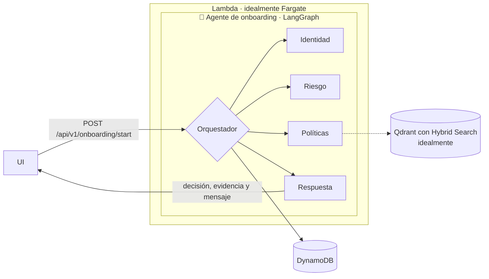
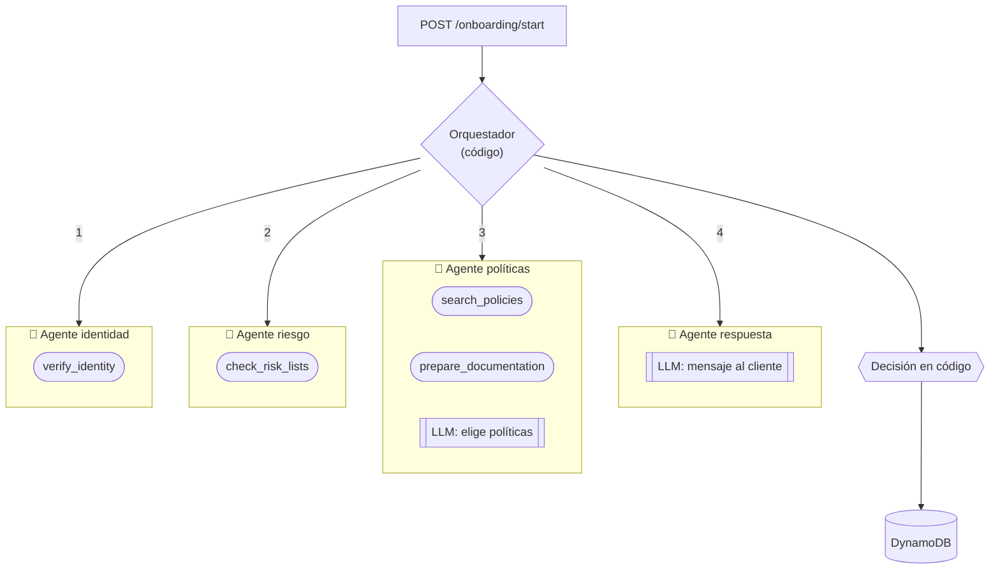

<h1 align="center">Onboarding multiagente</h1>

<p align="center">
  
  
  
  
  
  
</p>

<p align="center">
  Abrir una cuenta exige verificar identidad, revisar listas de riesgo y aplicar las políticas del banco.<br/>
  Hecho a mano toma horas; hecho solo por un LLM, nadie puede auditarlo.<br/><br/>
  <strong>Agentes que hacen el trabajo en segundos, con los controles en el código y cada paso trazado.</strong>
</p>

---

## Quick Start

```bash
make install                 # uv sync con los grupos dev y eval
cp .env.example .env         # pon tu ANTHROPIC_API_KEY, o LLM_PROVIDER=mock sin red
make run                     # API en localhost:8000, front en /ui
```

Inicia un onboarding:

```bash
curl -X POST localhost:8000/api/v1/onboarding/start \
  -H 'content-type: application/json' \
  -d '{"prospect_name": "Juan Perez", "document_id": "1712345678", "product": "cuenta_ahorros"}'
```

Eso es todo. Con `LLM_PROVIDER=mock` el flujo corre completo con respuestas fijas, sin costo.

## Ejemplo

> Un prospecto con identidad verificada y sin coincidencias en listas, con Claude Haiku 5.5.

```jsonc
{
  "decision": "aprobado",
  "review_reasons": [],
  "identity": {"verified": true, "confidence": 0.95},
  "risk": {"risk_level": "low", "matches": []},
  "policies": [{"id": "POL-01", "titulo": "Conozca a su cliente (KYC)", "texto": "..."}, ...],
  "required_documents": ["Cédula de identidad vigente", "Planilla de servicio básico (máximo 3 meses)"],
  "answer": "Hola Juan, nos complace informarle que su solicitud de cuenta de ahorros ha sido aprobada...",
  "trace": [{"agente": "identidad", "tool": "verify_identity", "resultado": "verified=True confidence=0.95"}, ...],
  "trace_id": "9b23b38ce5e0fe3acfbbcc6cb6fbd249",
  "uso": {"tokens_entrada": 2826, "tokens_salida": 465}
}
```

Si la confianza de identidad baja de 0.8, hay riesgo alto o algo no cuadra, la decisión pasa a
`revision_humana` con el motivo, y el cliente recibe un mensaje neutro.

## Arquitectura



```jsonc
// entrada
{"prospect_name": "Juan Perez", "document_id": "1712345678", "product": "cuenta_ahorros"}
// salida, entre otros campos
{"verified": true, "confidence": 0.0-1.0}
{"risk_level": "low/medium/high", "matches": []}
{"policies": []}
{"answer": "..."}
```

Hoy las políticas se buscan con BM25 en memoria; Qdrant con búsqueda híbrida es el reemplazo
para producción, porque BM25 no entiende sinónimos.

## Cómo funciona

Un orquestador en LangGraph recorre los agentes en orden fijo, a cada uno le pasa solo lo que
necesita y aplica las reglas de escalamiento. **El código decide; el LLM solo elige qué políticas
aplican y redacta el mensaje.**



| Agente | Tools permitidas | LLM | Produce |
| --- | --- | --- | --- |
| `identidad` | `verify_identity` | no | `verified`, `confidence` |
| `riesgo` | `check_risk_lists` | no | `risk_level`, `matches` |
| `politicas` | `search_policies` (BM25, k = 5), `prepare_documentation` | sí | políticas citadas, requisitos, documentos |
| `respuesta` | ninguna | sí | mensaje al cliente |

Los controles que no dependen del modelo:

| Riesgo | Control |
| --- | --- |
| Agente usa una tool ajena | lista de tools por agente, cualquier otra se rechaza |
| Prompt injection | el nombre solo acepta letras y nunca llega al LLM |
| PII | el LLM no recibe nombre ni cédula; la base y los logs guardan un hash |
| Alucinación | las políticas citadas deben estar entre las recuperadas |
| Revelar listas al cliente | el mensaje no puede mencionar listas, sanciones ni PEP |
| Servicio externo caído | un reintento y, si falla, revisión humana en vez de error |

```
app/
├── main.py  schemas.py  store.py  lambda_handler.py
├── routers/onboarding.py     ← solo HTTP
├── agent/                    ← sin FastAPI, se prueba y evalúa solo
│   ├── workflow.py           ← grafo de LangGraph
│   ├── tools.py              ← tools y permisos por agente
│   ├── guardrails.py         ← escalamiento y validación de salida
│   └── prompts.py
└── services/                 ← sin dominio: llm, retrieval, pii, observabilidad
```

## API

| Método | Ruta | Qué hace |
| --- | --- | --- |
| `POST` | `/api/v1/onboarding/start` | Corre el flujo y devuelve decisión, evidencia y traza |
| `GET` | `/api/v1/onboarding/{id}` | Registro guardado, sin PII (404 si no existe) |
| `GET` | `/health` | Estado del servicio |

Entrada inválida responde 422: nombre con símbolos, cédula que no tiene 10 dígitos o producto
fuera de `cuenta_ahorros`, `cuenta_corriente`, `tarjeta_credito` y `credito_consumo`.

## Observabilidad

Cada onboarding es una traza en [Langfuse](https://langfuse.com) con una observación por agente,
tool, guardrail y llamada al LLM, con su entrada, salida y tokens. Todo pasa por un filtro de
PII antes de salir.

```
onboarding                      ← traza, session_id = onboarding_id
├── orquestador                 ← chain
├── identidad                   ← agent
│   └── verify_identity         ← tool
├── riesgo
│   └── check_risk_lists
├── orquestador
│   └── escalamiento            ← guardrail, WARNING si escala
├── politicas
│   ├── search_policies
│   ├── prepare_documentation
│   ├── llm:SeleccionPoliticas  ← generation
│   └── validar_seleccion
└── respuesta
    ├── llm:MensajeCliente
    └── validar_mensaje
```

Se activa con `LANGFUSE_PUBLIC_KEY`, `LANGFUSE_SECRET_KEY` y `LANGFUSE_BASE_URL` en `.env`;
sin ellas no se envía nada y la app corre igual.

## Evaluación

19 casos en `eval/golden.jsonl`: caminos felices, identidad dudosa, OFAC, PEP, homónimos,
servicios caídos, prompt injection y entradas inválidas.

```bash
make eval                     # con la API corriendo
make eval REPETICIONES=3      # consistencia entre corridas
```

| Métrica | Valor |
| --- | --- |
| Accuracy de la decisión | 0.89 |
| Recall de `revision_humana` | 0.89 |
| Context recall | 0.97 |
| Faithfulness | 0.30 |
| Costo por onboarding | ~0.0006 USD |

Detalle, casos que fallan y su causa en [docs/evaluacion.md](./docs/evaluacion.md).

## Despliegue en AWS

```bash
make deploy                   # build de la Lambda, CDK y carga de secretos desde .env
make deploy-cdn               # igual, con CloudFront para HTTPS
make destroy                  # borra el stack
```

Todo el stack se configura en `infra/config.json`. La primera vez por cuenta y región:
`cd infra && npx -y aws-cdk@2.1145.0 bootstrap`.

## Comandos

```bash
make install                  # dependencias
make test                     # tests
make run                      # API local, front en /ui
make eval                     # evaluación
make deploy                   # despliegue en AWS
```

## Documentación

- [docs/diseno.md](./docs/diseno.md), diseño original del caso
- [docs/evaluacion.md](./docs/evaluacion.md), golden dataset, métricas y resultados
